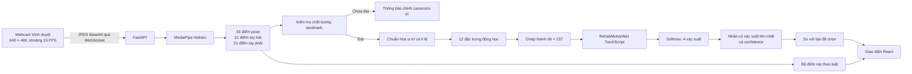
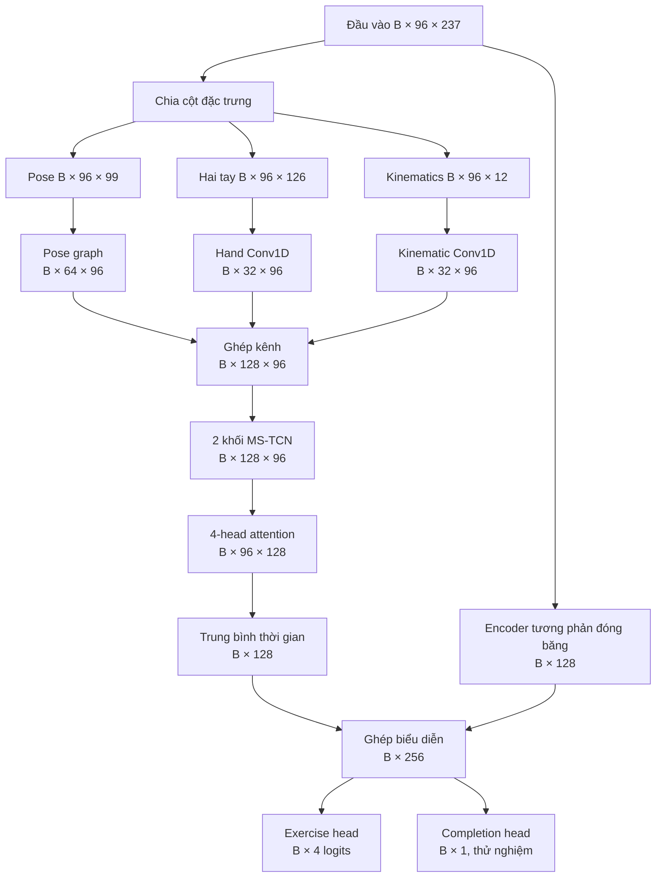

# Tài liệu kỹ thuật: mô hình nhận diện động tác và cơ chế cảnh báo của RehabAI

> Cập nhật theo mã nguồn và gói mô hình đang được triển khai trong dự án ngày 16/09/2026.  
> Phạm vi: hệ thống RehabAI trong thư mục `rehabai/`, đặc biệt là gói `artifacts/model_v2`.

## 1. Kết luận nhanh

Mô hình đang được ứng dụng dùng để **nhận diện loại bài tập** là **RehabMotionNet upper-limb v2**, phiên bản gói mô hình `1.1`, chữ ký kiến trúc `rehab_motionnet_upper_limb_v2`.

Đây là mô hình học sâu theo chuỗi thời gian, viết bằng PyTorch, nhận đầu vào là **96 khung hình × 237 đặc trưng**. Nó kết hợp:

- khung xương phần thân trên do MediaPipe Holistic trích xuất;
- landmark của hai bàn tay;
- 12 đặc trưng động học như góc vai, góc khuỷu, độ nghiêng thân và vận tốc;
- nhánh đồ thị không gian cho các khớp tay;
- tích chập thời gian đa tỉ lệ (MS-TCN);
- Multi-head Attention;
- một bộ mã hóa chuyển động đã tiền huấn luyện tương phản (contrastive learning);
- đầu phân loại Softmax cho 4 bài tập.

Điểm rất quan trọng: **hệ thống hiện chưa có mô hình đã được kiểm chứng để chấm đúng/sai chi tiết của tư thế hoặc nhận diện từng lỗi lâm sàng**. Phần gọi chung là “cảnh báo” hiện được tạo bởi nhiều luật và tín hiệu khác nhau, không phải hoàn toàn do RehabMotionNet:

1. kiểm tra chất lượng hình ảnh/landmark;
2. so sánh bài tập mô hình nhận diện với bài người dùng đã chọn;
3. đếm lần tập bằng ngưỡng góc và máy trạng thái;
4. đưa khuyến nghị sau tập theo mức đau do người dùng tự khai báo;
5. lọc từ khóa an toàn/cấp cứu trong chatbot, sau đó mới có thể gọi mô hình ngôn ngữ.

Vì vậy, cách mô tả chính xác nhất là: **RehabMotionNet nhận diện bài tập; các luật nghiệp vụ tạo phần lớn cảnh báo và khuyến nghị an toàn hiện tại.**

---

## 2. Bốn bài tập mà mô hình phân loại

Mô hình có 4 lớp đầu ra:

| Chỉ số đầu ra | ID chuẩn | Bài tập hiển thị |
|---:|---:|---|
| 0 | 1 | Vai - Nâng vật |
| 1 | 2 | Khuỷu tay - Duỗi khuỷu tay |
| 2 | 3 | Cổ tay - Gập/duỗi hoặc nâng cổ tay |
| 3 | 4 | Bàn tay - Mở bàn tay |

Ánh xạ này được đọc từ gói artifact thay vì viết cứng theo giả định. Backend còn kiểm tra ánh xạ có khớp với `exercise_registry.json` hay không trước khi phục vụ suy luận.

## 3. Luồng hoạt động từ webcam đến kết quả



### 3.1. Thu hình

Frontend lấy webcam ở độ phân giải yêu cầu 640 × 480, tạo ảnh JPEG chất lượng 0,6 và gửi khoảng 15 khung/giây qua WebSocket `/ws/inference`.

### 3.2. Trích xuất khung xương và bàn tay

Backend dùng **MediaPipe Holistic 0.10.21**, chế độ video và `model_complexity=1`, để lấy:

- pose: 33 landmark, mỗi landmark gồm `(x, y, z)`;
- tay trái: 21 landmark × 3 tọa độ;
- tay phải: 21 landmark × 3 tọa độ.

Nếu không phát hiện được một nhóm landmark, hệ thống điền các giá trị 0 cho nhóm đó.

#### 3.2.1. “Pose” là gì?

Pose không phải ảnh người đã được cắt ra và cũng không phải nhãn tên động tác. Pose là một bộ **điểm mốc hình học** đại diện cho vị trí các bộ phận cơ thể mà MediaPipe ước lượng từ ảnh RGB.

MediaPipe Pose quy ước 33 điểm. Các điểm liên quan trực tiếp nhất tới bài tập chi trên là:

| Chỉ số | Điểm cơ thể | Vai trò trong dự án |
|---:|---|---|
| 0 | Mũi | có trong vector pose nhưng không được nhánh graph chính dùng |
| 11, 12 | Vai trái, vai phải | tạo tâm cơ thể, độ rộng vai, góc vai và graph chi trên |
| 13, 14 | Khuỷu trái, khuỷu phải | tính góc vai/khuỷu và graph chi trên |
| 15, 16 | Cổ tay trái, cổ tay phải | tính góc/vận tốc cổ tay và graph chi trên |
| 17–22 | ngón út, ngón trỏ, ngón cái ở hai bên | có trong pose; bàn tay chi tiết vẫn lấy từ 21 hand landmark riêng |
| 23, 24 | Hông trái, hông phải | tính góc vai và độ nghiêng thân |
| 25–32 | Gối, cổ chân, gót và bàn chân | có trong vector đầu vào nhưng không vào nhánh graph chi trên chính |

Với mỗi điểm pose, backend hiện giữ ba số:

- `x`: vị trí ngang, thường được chuẩn hóa theo chiều rộng ảnh; 0 gần mép trái, 1 gần mép phải;
- `y`: vị trí dọc, chuẩn hóa theo chiều cao ảnh; 0 ở phía trên, 1 ở phía dưới;
- `z`: độ sâu tương đối do MediaPipe ước lượng, **không phải khoảng cách mét đo bằng camera chiều sâu**.

Ví dụ một khung có thể chứa:

```text
vai trái   = [0.42, 0.31, -0.08]
vai phải   = [0.58, 0.31, -0.06]
khuỷu trái = [0.36, 0.45, -0.10]
...
```

Các con số trên chỉ minh họa định dạng. RehabAI không đưa ảnh RGB thẳng vào RehabMotionNet. Ảnh đi qua MediaPipe trước, rồi mô hình nhận chuỗi tọa độ landmark và đặc trưng động học. Cách làm này giảm rất nhiều số chiều so với xử lý toàn bộ pixel và giúp mô hình tập trung vào chuyển động cơ thể.

Ngoài 33 pose landmark, mỗi bàn tay có 21 điểm riêng: cổ tay, các khớp và đầu ngón. Vì vậy hệ thống có thể quan sát việc mở bàn tay chi tiết hơn so với chỉ dùng các điểm cổ tay/ngón thô trong pose.

#### 3.2.2. Một khung hình được biến đổi như thế nào?

Với từng ảnh nhận từ trình duyệt, thứ tự xử lý thật trong backend là:

```text
JPEG Base64
  → giải mã bằng OpenCV thành ảnh BGR
  → đổi BGR sang RGB
  → MediaPipe Holistic.process(...)
  → pose (33, 3), tay trái (21, 3), tay phải (21, 3)
  → nếu thiếu cả nhóm thì thay bằng ma trận 0
  → thêm vào ba bộ đệm có độ dài tối đa 96
  → trả landmark mới nhất để frontend vẽ các chấm skeleton
```

MediaPipe chạy ở `static_image_mode=False`, nên nó xử lý đây là video liên tục và có thể tận dụng thông tin theo dõi từ các khung trước. `model_complexity=1` là lựa chọn cân bằng giữa tốc độ và độ chính xác cho thời gian thực; lúc trích xuất dữ liệu huấn luyện dự án từng dùng mức phức tạp cao hơn.

#### 3.2.3. Kiểm tra chất lượng landmark trong mã hiện tại

Hàm `quality_status()` thực hiện đúng các bước sau:

1. Nếu bộ đệm pose chưa có khung nào, trả `ready=false`, mã `no_frames`.
2. Lấy sáu điểm 11–16, tức hai vai, hai khuỷu và hai cổ tay, trên tất cả khung đang có.
3. Với mỗi khung, kiểm tra **có bất kỳ giá trị nào khác 0 trong nhóm sáu điểm hay không**.
4. Tính:

   ```text
   landmark_rate = số khung được coi là hợp lệ / số khung hiện có
   ```

5. Nếu `landmark_rate < 0,60`, trả `insufficient_upper_limb` và không cho model suy luận.
6. Nếu chưa đủ 96 khung, trả `collecting_window`.
7. Khi đủ 96 khung và rate đạt ít nhất 60%, trả `ready=true`.

Ví dụ: trong cửa sổ 96 khung, nếu 70 khung có tín hiệu khác 0 ở nhóm vai–khuỷu–cổ tay thì:

```text
landmark_rate = 70 / 96 = 0,729
```

Quality gate sẽ cho qua vì 0,729 ≥ 0,60.

Tên thông báo nói “đã thấy đủ tay”, nhưng điều kiện mã nguồn hiện tại thực tế còn lỏng hơn câu đó: nó dùng `np.any(...)` trên toàn bộ sáu khớp, nên chỉ cần một phần nhóm có giá trị khác 0 là khung đã có thể được đánh dấu hợp lệ. Nó chưa kiểm tra:

- từng vai, khuỷu và cổ tay đều hiện diện;
- điểm nào có `visibility` hoặc `presence` đủ cao;
- người có bị cắt mất một bên tay hay không;
- có nhiều người trong ảnh hay không;
- landmark có nhảy bất thường giữa hai khung hay không;
- ánh sáng, độ mờ hoặc góc camera có đạt yêu cầu hay không.

Do backend bỏ trường `visibility` và chỉ giữ `(x,y,z)`, quality gate cũng không thể dùng confidence từng landmark. Vì vậy `ready=true` chỉ nên hiểu là **đủ điều kiện kỹ thuật tối thiểu theo luật hiện tại**, không có nghĩa mọi landmark đều chính xác.

#### 3.2.4. Quality gate ảnh hưởng đến các nhánh sau ra sao?

- Nếu `ready=false`, backend vẫn gửi skeleton và thông báo chất lượng về frontend, nhưng bỏ qua RehabMotionNet.
- Bộ đếm rep cũng nhận `quality_ready=false` nên không cập nhật chu kỳ động tác ở khung đó.
- Nếu `ready=true`, cửa sổ 96 khung được chuẩn hóa, tạo đặc trưng và đưa vào model.
- Những nhóm landmark MediaPipe không thấy vẫn là số 0 trong bộ đệm. Sau phép chuẩn hóa, số 0 này không còn nhất thiết giữ nguyên 0 vì hệ thống trừ tâm vai; do đó việc nâng cấp mask/visibility là quan trọng để mô hình phân biệt “điểm bị thiếu” với “điểm thật”.

### 3.3. Cửa sổ thời gian

Hệ thống giữ một bộ đệm trượt gồm 96 khung hình. Khi đã đủ 96 khung, cứ thêm 5 khung mới thì chạy suy luận một lần. Với tốc độ gửi khoảng 15 FPS:

- lần dự đoán đầu tiên cần khoảng `96 / 15 = 6,4 giây` để lấp đầy bộ đệm;
- sau đó có dự đoán mới khoảng mỗi `5 / 15 = 0,33 giây`.

Đây là ước lượng theo frontend; tốc độ thực tế còn phụ thuộc camera, mạng nội bộ và CPU/GPU.

### 3.4. Chuẩn hóa hình học

Để giảm ảnh hưởng của vị trí đứng và khoảng cách tới camera, tất cả landmark được:

1. tịnh tiến theo trung điểm hai vai;
2. chia theo khoảng cách giữa hai vai.

Về ý tưởng:

```text
landmark_chuẩn_hóa = (landmark - trung_điểm_hai_vai) / độ_rộng_vai
```

Nhờ vậy, mô hình tập trung hơn vào hình dạng/chuyển động tương đối, thay vì tọa độ pixel tuyệt đối hoặc kích thước cơ thể trên ảnh.

### 3.5. Tạo vector 237 đặc trưng

Mỗi khung hình được biểu diễn bởi:

| Nhóm | Kích thước | Nội dung |
|---|---:|---|
| Pose | 33 × 3 = 99 | tọa độ 3D tương đối của 33 điểm cơ thể |
| Tay trái | 21 × 3 = 63 | tọa độ 21 điểm bàn tay trái |
| Tay phải | 21 × 3 = 63 | tọa độ 21 điểm bàn tay phải |
| Động học | 12 | góc và vận tốc |
| **Tổng** | **237** | đặc trưng cho một khung |

12 đặc trưng động học gồm:

- góc vai trái và vai phải;
- góc khuỷu trái và khuỷu phải;
- độ nghiêng thân;
- vận tốc góc của 5 góc trên;
- độ lớn vận tốc cổ tay trái và cổ tay phải.

#### 3.5.1. Công thức tính góc

Góc tại điểm giữa `B` của ba điểm `A–B–C` được tính từ hai vector:

```text
u = A - B
v = C - B

góc(u,v) = arccos((u · v) / (||u|| × ||v||))
```

Giá trị dot product được chặn trong `[-1, 1]` để tránh lỗi số học của `arccos`. Trong vector 12 đặc trưng, các góc được lưu bằng **radian**, không phải độ.

#### 3.5.2. Ý nghĩa chi tiết của 12 đặc trưng

Thứ tự thật trong vector kinematics là:

| STT | Tên đặc trưng | Cách tính | Ý nghĩa trực giác |
|---:|---|---|---|
| 1 | `L_shoulder_angle` | góc giữa `(vai trái − hông trái)` và `(khuỷu trái − vai trái)` | tay trái nâng xa thân đến mức nào |
| 2 | `R_shoulder_angle` | tương tự bên phải | tay phải nâng xa thân đến mức nào |
| 3 | `L_elbow_angle` | góc giữa `(vai trái − khuỷu trái)` và `(cổ tay trái − khuỷu trái)` | khuỷu trái đang gập hay duỗi |
| 4 | `R_elbow_angle` | tương tự bên phải | khuỷu phải đang gập hay duỗi |
| 5 | `trunk_inclination` | góc giữa vector trung điểm hông → trung điểm vai và hướng thẳng đứng ảnh `(0,-1,0)` | thân người nghiêng khỏi phương thẳng đứng bao nhiêu |
| 6–10 | vận tốc góc của 5 góc trên | `(góc[t] − góc[t−1]) / Δt` | góc đang thay đổi nhanh và theo chiều nào |
| 11 | `L_wrist_velocity` | `||cổ_tay_trái[t] − cổ_tay_trái[t−1]|| / Δt` | tốc độ tịnh tiến tương đối của cổ tay trái |
| 12 | `R_wrist_velocity` | tương tự bên phải | tốc độ tịnh tiến tương đối của cổ tay phải |

Trong code thời gian thực:

```text
fps = 30
Δt  = 1 / fps = 1/30 giây
```

Với frame đầu tiên chưa có frame trước để lấy sai phân, hệ thống sao chép vận tốc của frame thứ hai về frame đầu. Nếu chuỗi chỉ có một frame thì dùng 0, nhưng cửa sổ suy luận thực tế cần 96 frame.

#### 3.5.3. Vì sao cần 12 đặc trưng nếu đã có tọa độ?

Mạng về lý thuyết có thể tự học góc/vận tốc từ tọa độ, nhưng với dữ liệu nhỏ việc cung cấp sẵn các đại lượng có ý nghĩa giúp mô hình dễ nhận ra mẫu hơn:

- bài vai: góc vai thay đổi rõ;
- bài duỗi khuỷu: góc khuỷu tiến về trạng thái duỗi;
- bài cổ tay: chuyển động của cổ tay/bàn tay và vận tốc có ích;
- nghiêng thân có thể cho biết chuyển động bù, dù hiện chưa có nhãn để biến nó thành cảnh báo lỗi lâm sàng.

Nói cách khác, tọa độ cho biết **“các điểm đang ở đâu”**, còn kinematics tóm tắt **“các khớp tạo góc gì và đang thay đổi nhanh thế nào”**.

#### 3.5.4. Ví dụ kích thước của một cửa sổ

Sau 96 khung:

```text
pose       : (96, 33, 3) → flatten → (96,  99)
tay trái   : (96, 21, 3) → flatten → (96,  63)
tay phải   : (96, 21, 3) → flatten → (96,  63)
kinematics :                         (96,  12)
                                            ----
ghép theo chiều đặc trưng            (96, 237)
```

Khi đưa vào PyTorch, backend thêm chiều batch:

```text
(96, 237) → unsqueeze(0) → (1, 96, 237)
```

Trong đó `1` là một cửa sổ, `96` là thời gian và `237` là số đặc trưng mỗi thời điểm.

Các đặc trưng động học còn được standardize bằng mean và standard deviation lưu trong chính gói mô hình. Thống kê chuẩn hóa chỉ được fit trên phần training của fold tương ứng nhằm tránh rò rỉ dữ liệu.

Lưu ý kỹ thuật: luồng thời gian thực hiện tính động học với `fps=30`, trong khi frontend đang gửi mục tiêu khoảng 15 FPS. Góc hình học không bị ảnh hưởng trực tiếp, nhưng trị số vận tốc có thể lệch tỉ lệ so với thời gian thu thực tế. Đây là điểm nên đồng bộ trong một bản nâng cấp sau.

---

## 4. Kiến trúc RehabMotionNet

Gói đang triển khai bật đầy đủ các cờ:

```text
use_hand        = true
use_kinematic   = true
use_contrastive = true
use_mstcn       = true
use_attention   = true
upper_limb_only = true
```

### 4.1. Nhánh pose dạng đồ thị

Mặc dù đầu vào chứa đủ 33 điểm pose, cấu hình `upper_limb_only=true` chỉ đưa 6 điểm sau vào nhánh pose chính:

- vai trái/phải: 11, 12;
- khuỷu trái/phải: 13, 14;
- cổ tay trái/phải: 15, 16.

`PoseGraphBranch` học một ma trận liên kết `A` kích thước 6 × 6. Phép nhân đồ thị cho phép mỗi khớp tổng hợp thông tin từ các khớp khác. Sau đó mạng dùng:

- `Conv2d 1×1` để biến đổi kênh tọa độ;
- convolution theo thời gian với kernel 3;
- ReLU;
- trung bình theo các node.

Đầu ra của nhánh này có 64 kênh theo thời gian.

### 4.2. Nhánh hai bàn tay

Hai bàn tay được ghép thành 126 giá trị mỗi khung và đi qua `Conv1d` kernel 3, tạo 32 kênh. Nhánh này đặc biệt quan trọng với bài mở bàn tay và chuyển động cổ tay.

### 4.3. Nhánh động học

12 góc/vận tốc đi qua một `Conv1d` kernel 3 khác để tạo 32 kênh. Nhánh này cung cấp thông tin có ý nghĩa cơ học rõ hơn tọa độ thô.

### 4.4. Hợp nhất theo thời gian bằng MS-TCN

Ba nhánh tạo tổng cộng `64 + 32 + 32 = 128` kênh. Dữ liệu được đưa qua hai khối **Multi-Scale Temporal Convolutional Network**.

Mỗi khối có ba convolution song song với dilation 1, 2 và 4. Cách này giúp mô hình đồng thời quan sát:

- thay đổi ngắn hạn;
- chuyển động trung hạn;
- mẫu chuyển động dài hơn;

mà không cần kernel quá lớn. Kết quả được ghép kênh, Batch Normalization, cộng residual và qua ReLU.

### 4.5. Multi-head Attention

Sau MS-TCN, `MultiheadAttention` với 4 head học khung thời gian nào đáng chú ý hơn trong toàn bộ động tác. Có residual connection giữa đầu vào và đầu ra attention.

Tiếp theo, global mean pooling lấy trung bình theo 96 khung để tạo một vector đại diện cho cả đoạn chuyển động.

### 4.6. Nhánh biểu diễn tiền huấn luyện tương phản

Một `SharedMotionEncoder` riêng nhận toàn bộ vector 237 chiều và sử dụng các khối MS-TCN để tạo embedding 128 chiều. Bộ mã hóa này được tiền huấn luyện bằng contrastive learning kiểu SimCLR/NT-Xent: hai phiên bản biến đổi của cùng một chuỗi được kéo gần nhau, còn các chuỗi khác được đẩy xa nhau trong không gian biểu diễn.

Khi huấn luyện mô hình phân loại, encoder tiền huấn luyện được đóng băng. Embedding 128 chiều của nó được ghép với vector từ nhánh có giám sát.

Mục đích là học “dáng chuyển động” tổng quát trước, sau đó tận dụng biểu diễn đó khi số mẫu có nhãn không lớn.

### 4.7. Hai đầu ra multi-task

Mạng có hai head:

1. `ex_head`: logits của 4 loại bài tập;
2. `comp_head`: một giá trị về trạng thái hoàn thành.

Trong sản phẩm hiện tại, **chỉ đầu nhận diện bài tập được sử dụng**. Completion head bị giữ ở mức thử nghiệm và backend trả `completion_status = null`, vì kết quả đánh giá chưa đủ để đưa vào sử dụng.

Với đầu phân loại, Softmax biến logits thành phân phối xác suất:

```text
p_i = exp(logit_i) / tổng_j exp(logit_j)
```

Lớp có `p_i` lớn nhất được chọn. Giá trị lớn nhất được hiển thị dưới tên “độ tự tin tương đối”. Đây không phải xác suất đã được hiệu chuẩn lâm sàng.

### 4.8. Dòng chảy tensor bên trong RehabMotionNet

Với một cửa sổ, tensor đi qua mạng như sau:



`B` là batch size; ở backend thời gian thực, `B=1`.

### 4.9. Cơ chế của từng khối, diễn giải trực giác

#### A. Pose graph: học quan hệ giữa các khớp

Đầu vào pose có 33 điểm nhưng nhánh graph chính chọn 6 điểm vai–khuỷu–cổ tay. Tọa độ được đổi thứ tự thành:

```text
(B, thời gian, khớp, xyz) → (B, xyz, thời gian, khớp)
```

Ma trận `A` kích thước 6 × 6 là tham số được học. Phép:

```text
AX = tổng thông tin từ các khớp khác cho mỗi khớp đích
```

giúp mạng kết hợp, chẳng hạn, vị trí cổ tay với khuỷu và vai thay vì nhìn từng điểm riêng lẻ. Trong implementation này, `A` là ma trận dense khởi tạo ngẫu nhiên và được học trực tiếp; nó không bị khóa theo đúng các cạnh giải phẫu và cũng không được chuẩn hóa bằng Softmax. Vì vậy tên gọi chính xác là một nhánh graph có adjacency học được, không phải mô hình xương giải phẫu cố định.

Sau phép graph:

- convolution `1×1` đổi 3 kênh `(x,y,z)` thành 64 kênh đặc trưng;
- convolution kernel `(3,1)` xem ba thời điểm lân cận của cùng khớp;
- trung bình qua 6 khớp tạo `(B,64,96)`.

#### B. Hand và kinematics Conv1D: tìm mẫu cục bộ theo thời gian

`Conv1D(kernel=3)` nhìn ba frame liên tiếp. Bộ lọc có thể học các mẫu như:

- các đầu ngón đang tách xa nhau;
- góc khuỷu tăng đều;
- cổ tay đổi hướng;
- vận tốc tăng rồi giảm ở cuối một pha.

Nhánh hand tạo 32 kênh; nhánh kinematics tạo 32 kênh. Các kênh không có tên cố định do con người đặt mà là pattern mạng tự học trong quá trình tối ưu.

#### C. MS-TCN: hiểu chuyển động ở nhiều khoảng thời gian

Một convolution kernel 3 thông thường chỉ xem các vị trí gần nhau. MS-TCN chạy ba nhánh dilation song song:

```text
dilation 1: lấy t-1, t, t+1
dilation 2: lấy t-2, t, t+2
dilation 4: lấy t-4, t, t+4
```

Nhờ đó cùng một block quan sát chuyển động nhanh lẫn xu hướng dài hơn. Hai block liên tiếp tiếp tục mở rộng vùng thời gian mà đầu ra có thể sử dụng. Residual connection giữ lại tín hiệu cũ và giúp gradient truyền ổn định hơn khi huấn luyện.

#### D. Attention: các thời điểm tự tham chiếu lẫn nhau

Multi-head self-attention tạo Query, Key và Value từ chuỗi. Ở mức khái niệm:

```text
Attention(Q,K,V) = softmax(QKᵀ / √d) V
```

Mỗi frame có thể lấy thông tin từ mọi frame khác trong cửa sổ 96 frame. Bốn head có thể học bốn kiểu quan hệ khác nhau, ví dụ giai đoạn bắt đầu, biên độ cực đại, quay về và chuyển động bàn tay. Đây là diễn giải trực giác; code không gán sẵn ý nghĩa cụ thể cho từng head.

Sau attention có residual `fused + attn_out`, rồi trung bình toàn bộ thời gian. Vì dùng mean pooling, model tạo một mô tả chung cho cả cửa sổ, chứ không xuất nhãn phase cho từng frame.

#### E. Contrastive encoder: thêm “dấu vân tay chuyển động” đã học trước

Encoder đóng băng chạy song song trên toàn bộ 237 đặc trưng và trả embedding 128 chiều. Khi tiền huấn luyện, hai bản augmentation của cùng một chuyển động được coi là cặp dương; các chuyển động khác là cặp âm. Loss khuyến khích:

```text
embedding(cùng chuyển động)  → gần nhau
embedding(khác chuyển động)  → xa nhau
```

Khi huấn luyện classifier, encoder này không cập nhật trọng số. Vector 128 chiều của nó được ghép với vector 128 chiều từ nhánh supervised thành 256 chiều.

Một chi tiết dễ bỏ sót: `upper_limb_only=true` giới hạn **nhánh pose graph chính** ở sáu khớp, nhưng contrastive encoder vẫn nhận toàn bộ vector 237 chiều. Vì vậy toàn mạng không hoàn toàn chỉ nhìn sáu khớp.

#### F. Classification head: biến biểu diễn thành tên bài

Lớp tuyến tính cuối biến vector 256 chiều thành bốn logits, chẳng hạn:

```text
logits = [1.2, 3.4, 0.1, -0.7]
softmax ≈ [0.095, 0.859, 0.032, 0.014]
```

Ví dụ này sẽ chọn output index 1, ánh xạ thành Exercise 2. Các số chỉ để minh họa phép tính, không phải kết quả thật của một video.

Model không dùng một luật kiểu “góc khuỷu > X thì Exercise 2”. Thay vào đó, các trọng số của toàn mạng được học từ dữ liệu để bốn logits phản ánh pattern tổng hợp của pose, tay, động học và diễn biến thời gian.

### 4.10. Từ kết quả model đến thông báo trên giao diện

Sau khi có `exercise_id` và `confidence`, backend:

1. ánh xạ output index sang ID chuẩn bằng `class_mapping` trong artifact;
2. lấy tên tiếng Việt từ registry/display mapping;
3. nếu có phiên tập, so sánh ID dự đoán với ID người dùng đã chọn;
4. trả JSON qua WebSocket;
5. frontend hiển thị tên bài và confidence;
6. nếu hai ID khác nhau, frontend hiện “Hãy thực hiện đúng bài...”.

Không có ngưỡng confidence trong bước này. Ngay cả phân phối gần như `[0,26; 0,25; 0,25; 0,24]`, hệ thống vẫn chọn lớp 0. Đây là lý do tài liệu khuyến nghị thêm cơ chế `unknown/abstain`, threshold và làm mượt nhiều cửa sổ trước khi phát cảnh báo sai bài.

---

## 5. Mô hình được huấn luyện và đánh giá như thế nào?

### 5.1. Dữ liệu chính

Theo model card:

- nguồn Upper Limb Stroke có 491 video nguồn;
- 387 mẫu vượt qua quality gate phần chi trên và được dùng trong đánh giá;
- có 10 subject;
- tác vụ chính là phân loại 4 bài tập.

### 5.2. Strict subject-wise LOSO

Phương pháp đánh giá là **10-fold Leave-One-Subject-Out (LOSO)**. Ở mỗi fold:

- một người được giữ hoàn toàn làm test;
- các subject khác dùng cho train/validation;
- mean/std chuẩn hóa chỉ được tính từ training partition;
- test subject không được dùng để chọn checkpoint, fit chuẩn hóa hoặc tạo pseudo-label.

LOSO phù hợp với bài toán này hơn chia ngẫu nhiên theo video, bởi chia ngẫu nhiên có thể để video của cùng một người xuất hiện ở cả train và test, làm điểm số cao giả tạo. LOSO đo khả năng tổng quát sang **người chưa từng thấy**.

### 5.3. Hàm mất mát và tối ưu

Pipeline huấn luyện chính hỗ trợ:

- Cross-Entropy có trọng số lớp cho nhận diện bài tập;
- BCEWithLogits có `pos_weight` cho completion head;
- AdamW;
- Cosine Annealing learning-rate scheduler;
- mixed precision khi dùng CUDA;
- augmentation chỉ ở training;
- early stopping theo validation Macro-F1;
- kiểm tra provenance/hash của manifest và checkpoint.

Các augmentation hiện có gồm nhiễu Gaussian, xoay ngẫu nhiên và che ngẫu nhiên landmark. Mục tiêu là làm mô hình bớt phụ thuộc vào nhiễu camera hoặc một cấu hình cơ thể cụ thể.

### 5.4. Kết quả đã ghi nhận

Đánh giá tổng hợp 10 fold của upper-limb v2:

| Chỉ số | Trung bình | Độ lệch chuẩn |
|---|---:|---:|
| Accuracy nhận diện bài tập | 0,4379 | 0,2335 |
| Macro-F1 nhận diện bài tập | 0,3544 | 0,2704 |
| Macro-F1 completion, thử nghiệm | 0,4828 | — |

Độ lệch chuẩn rất lớn cho thấy hiệu năng thay đổi mạnh giữa các subject. Các subject 07–10 còn có độ phủ lớp hạn chế. Vì vậy, đây là mô hình **nghiên cứu/demo**, chưa phải thiết bị chẩn đoán hay hệ thống chấm phục hồi chức năng đã được thẩm định lâm sàng.

### 5.5. Gói thực tế đang phục vụ

Backend mặc định mount `artifacts/model_v2` và nạp `model.pt` bằng TorchScript. Provenance trong artifact cho biết đây là checkpoint của `fold_04`:

- train: subject 01, 03, 05, 06, 07, 08, 09, 10;
- validation: subject 02;
- test của fold: subject 04;
- số mẫu train/validation/test: 277/51/59.

Do đó cần phân biệt:

- số liệu 0,3544 Macro-F1 là trung bình đánh giá của cả 10 fold;
- ứng dụng đang chạy **một checkpoint fold_04**, không phải ensemble 10 mô hình và cũng không phải một mô hình cuối được train lại trên toàn bộ 387 mẫu.

Các thử nghiệm CTR-GCN, ensemble, optimized-v1, external pretraining và teacher-student tồn tại trong repository nhưng **không phải artifact sản phẩm mặc định hiện tại**. Nhiều báo cáo cũng ghi rõ chưa cho phép promotion vì chưa có xác nhận trên subject mới.

---

## 6. Cơ chế đếm số lần tập

Đếm rep không lấy từ classification head. Nó là một bộ luật riêng `RuleBasedRepCounter` chạy trên landmark mới nhất.

Quy trình chung:

1. tính tín hiệu góc hoặc tỉ lệ bàn tay cho cả hai bên;
2. quan sát biên độ để khóa vào bên hoạt động rõ hơn;
3. lọc trung vị trên 5 giá trị gần nhất để giảm rung;
4. dùng hai ngưỡng `low/high` tạo hysteresis;
5. phải giữ điều kiện đủ 3 khung liên tiếp;
6. chuyển `REST → ACTIVE → REST` mới tính một rep;
7. cooldown tối thiểu 0,7 giây giữa hai rep.

| Bài | Tín hiệu | Ngưỡng thấp | Ngưỡng cao |
|---|---|---:|---:|
| Vai | góc hông–vai–khuỷu | 28° | 58° |
| Khuỷu | góc vai–khuỷu–cổ tay | 82° | 148° |
| Cổ tay | góc khuỷu–cổ tay–điểm gốc ngón giữa | 72° | 125° |
| Mở bàn tay | khoảng cách trung bình đầu ngón tới cổ tay / độ rộng lòng bàn tay | 1,15 | 1,65 |

Kết quả rep được gắn cờ `estimated: true`, nghĩa là **ước lượng**, không phải số đếm lâm sàng đã được thẩm định.

## 7. Các loại cảnh báo hiện có

### 7.1. Cảnh báo chất lượng camera/landmark

Trước khi suy luận, hệ thống kiểm tra nhóm landmark vai, khuỷu và cổ tay. Khi tỉ lệ khung có tín hiệu hợp lệ dưới 60%, hệ thống không chạy model và yêu cầu người dùng lùi xa/đưa tay vào khung hình. Khi bộ đệm chưa đủ 96 khung, UI hiển thị tiến độ thu thập.

Trong mã hiện tại, một khung được tính là hợp lệ nếu có ít nhất một giá trị khác 0 trong toàn bộ nhóm 6 khớp trên. Vì vậy đây là quality gate tương đối đơn giản, chưa kiểm tra visibility riêng cho từng khớp.

### 7.2. Cảnh báo đang làm khác bài đã chọn

Sau mỗi dự đoán, backend so sánh:

```text
exercise_id mô hình dự đoán == exercise_id của phiên tập
```

Nếu khác, frontend hiện thông báo “Hãy thực hiện đúng bài…”. Cảnh báo này phụ thuộc trực tiếp vào nhãn RehabMotionNet.

Giới hạn hiện tại:

- luôn chọn một trong 4 lớp, chưa có lớp “không phải bài tập/không xác định”;
- chưa đặt ngưỡng confidence tối thiểu;
- chưa làm mượt nhiều dự đoán liên tiếp;
- vì accuracy trung bình còn thấp, cảnh báo sai bài có thể sai hoặc dao động.

### 7.3. Khuyến nghị dựa trên đau sau tập

Người dùng tự chọn mức đau 0–10 trước và sau buổi tập. Sau khi kết thúc:

- nếu đau sau `>= 5` hoặc tăng ít nhất 2 điểm: đề nghị lần sau giảm mục tiêu khoảng 20–30% và trao đổi với chuyên viên nếu còn tăng;
- nếu đau tăng nhưng chưa chạm điều kiện trên: giữ nguyên/giảm nhẹ rep, tập chậm và dừng nếu đau tăng;
- nếu không tăng: chỉ tăng rep khi chuyên viên đồng ý và động tác vẫn không đau.

Đây là **luật hậu xử lý sau buổi tập**, không phải camera tự phát hiện đau và cũng chưa phải cảnh báo dừng tập tức thời.

### 7.4. Bộ lọc an toàn của chatbot

Chatbot có lớp xử lý ưu tiên trước mô hình ngôn ngữ:

- từ khóa cấp cứu như méo miệng, nói khó, yếu liệt đột ngột, đau ngực, khó thở nặng… dẫn đến hướng dẫn dừng tập và gọi cấp cứu;
- từ khóa đau/tê/sưng/chóng mặt… nhận phản hồi an toàn cố định;
- các yêu cầu bài nhẹ nhận hướng dẫn chung đã viết sẵn;
- chỉ các hội thoại còn lại mới có thể gọi OpenAI Responses API nếu backend có `OPENAI_API_KEY`;
- nếu không có API key hoặc gọi lỗi, hệ thống dùng thư viện câu trả lời cục bộ.

Mặc định Docker cấu hình tên mô hình hội thoại là `gpt-5-mini`, nhưng nó **không tham gia nhận diện hình ảnh, phân loại động tác hoặc đếm rep**.

### 7.5. Chức năng chưa có

Hiện hệ thống chưa được phép tuyên bố các khả năng sau:

- phát hiện chính xác nâng vai bù trừ, nghiêng thân, sai trục khuỷu hoặc sai kỹ thuật cụ thể;
- chấm chất lượng động tác theo chuẩn lâm sàng;
- xác định bệnh nhân đã hoàn thành đúng bài bằng completion head;
- tự phát hiện đau qua khuôn mặt/hình ảnh;
- chẩn đoán, kê đơn hoặc thay thế bác sĩ/kỹ thuật viên phục hồi chức năng.

Trong WebSocket, các trường tương ứng hiện là `phase: null`, `quality_score: null`, `completion_status: null`, còn feedback là “Chưa có đánh giá lỗi chi tiết”. Lý do là dự án chưa có bộ dữ liệu lỗi được chuyên gia gán nhãn và xác minh đủ để huấn luyện/đánh giá chức năng này.

---

## 8. Các công nghệ liên quan

| Tầng | Công nghệ | Vai trò |
|---|---|---|
| Computer vision | MediaPipe Holistic 0.10.21 | lấy pose và hai bàn tay từ ảnh webcam |
| Xử lý ảnh | OpenCV 4.9 | giải mã JPEG, đổi BGR/RGB |
| Mô hình AI | PyTorch 2.2.2 | huấn luyện và định nghĩa RehabMotionNet |
| Đóng gói model | TorchScript/JIT | lưu `model.pt`, nạp nhanh và không cần dựng lại class Python |
| Tính toán | NumPy, SciPy | vector đặc trưng, góc, vận tốc, nội suy chuỗi |
| Backend | FastAPI, Uvicorn | REST API và WebSocket thời gian thực |
| Lưu trữ | SQLAlchemy, SQLite | phiên tập, mức đau, lịch sử và khuyến nghị |
| Frontend | React 19, TypeScript, Vite | giao diện webcam, skeleton, kết quả và lịch sử |
| Triển khai | Docker Compose, Nginx | đóng gói frontend/backend và reverse proxy |
| Chat tùy chọn | OpenAI Responses API | hội thoại hỗ trợ, sau lớp quy tắc an toàn |
| Toàn vẹn artifact | SHA-256 | phát hiện file model/schema/registry bị thiếu hoặc thay đổi |

Backend tự chọn CUDA nếu có; Docker backend hiện khóa PyTorch CPU để dễ triển khai. Máy RTX 4060 chủ yếu có ích trong giai đoạn huấn luyện; suy luận demo vẫn có CPU fallback.

## 9. Điểm mạnh của phương pháp hiện tại

- Không cần cảm biến đeo: chỉ dùng webcam phổ thông.
- Mô hình học chuyển động theo chuỗi, thay vì phân loại từng ảnh độc lập.
- Kết hợp tọa độ thô, cấu trúc khớp, bàn tay và đặc trưng động học.
- Chuẩn hóa theo cơ thể giúp giảm phụ thuộc vị trí/khoảng cách camera.
- LOSO giảm nguy cơ đánh giá quá lạc quan do trùng người giữa train và test.
- Train và inference dùng chung logic preprocessing cốt lõi.
- Artifact có schema, class mapping, provenance và hash kiểm tra toàn vẹn.
- Tách nhận diện AI khỏi bộ đếm rep và luật an toàn giúp từng thành phần dễ kiểm tra hơn.

## 10. Hạn chế và rủi ro cần hiểu đúng

1. **Hiệu năng nhận diện còn thấp:** accuracy trung bình khoảng 43,8%, Macro-F1 khoảng 35,4%; chưa phù hợp để ra quyết định y khoa.
2. **Dữ liệu nhỏ:** chỉ 10 subject và độ phủ lớp không đều ở một số fold.
3. **Artifact triển khai là một fold:** không đại diện cho mô hình train lại trên toàn bộ dữ liệu.
4. **Không có lớp unknown:** mọi cửa sổ đủ điều kiện đều bị ép vào một trong 4 bài.
5. **Confidence chưa calibration:** số phần trăm không đồng nghĩa xác suất đúng trong thực tế.
6. **Chưa smoothing dự đoán:** nhãn có thể nhấp nháy giữa các lần suy luận.
7. **Đếm rep dựa trên ngưỡng cố định:** chưa cá nhân hóa theo tầm vận động của bệnh nhân đột quỵ.
8. **Quality gate đơn giản:** chưa đánh giá độ tin cậy/visibility từng khớp và chưa phát hiện che khuất tinh vi.
9. **Sai khác FPS:** frontend gửi khoảng 15 FPS nhưng động học được tính giả định 30 FPS.
10. **Chưa có nhãn lỗi chuyên gia:** không thể huấn luyện hợp lệ bộ phân loại lỗi kỹ thuật chi tiết.
11. **Khuyến nghị đau là hậu kiểm:** hệ thống không tự nhận biết triệu chứng đang xảy ra giữa lúc tập.
12. **MediaPipe có domain gap:** ánh sáng, góc camera, quần áo, che khuất, mức liệt và chuyển động rất chậm có thể làm landmark sai.

## 11. Nên phát triển tiếp như thế nào?

Thứ tự ưu tiên hợp lý:

1. Thu dữ liệu prospective trên subject mới, đủ cả 4 bài, đa dạng mức suy giảm và điều kiện camera.
2. Nhờ chuyên gia phục hồi chức năng thiết kế ontology lỗi rồi gán nhãn theo frame/phase/rep, có đo độ đồng thuận giữa người chấm.
3. Thêm lớp `unknown/out-of-distribution` và cơ chế abstain khi confidence thấp.
4. Hiệu chuẩn confidence bằng validation độc lập và chọn threshold cho từng lớp.
5. Làm mượt dự đoán theo thời gian, ví dụ majority vote hoặc EMA trên nhiều cửa sổ.
6. Đồng bộ timestamp/FPS thực tế khi tính vận tốc.
7. Nâng quality gate: visibility từng khớp, che khuất, người ngoài khung, nhiều người và góc camera.
8. Cá nhân hóa ngưỡng rep từ biên độ vận động ban đầu dưới sự duyệt của chuyên viên.
9. Tách phase segmentation và error detection thành các tác vụ có metric riêng.
10. Đánh giá độ nhạy/độ đặc hiệu của cảnh báo an toàn, không chỉ accuracy tổng.
11. Chỉ promotion mô hình mới sau protocol cố định, subject mới và kiểm định lâm sàng phù hợp.

## 12. Các file nguồn quan trọng để đọc tiếp

| Nội dung | File |
|---|---|
| Model card | `rehabai/artifacts/model_v2/model_card.md` |
| Cấu hình artifact đang chạy | `rehabai/artifacts/model_v2/model_config.json` |
| Metric chính thức | `rehabai/artifacts/model_v2/metrics.json` |
| Metadata fold triển khai | `rehabai/artifacts/model_v2/fold_metadata.json` |
| Schema đặc trưng | `rehabai/artifacts/model_v2/feature_schema.json` |
| Kiến trúc RehabMotionNet | `rehabai/training/models/rehab_motionnet.py` |
| MS-TCN và encoder | `rehabai/training/models/shared_encoder.py` |
| MediaPipe thời gian thực | `rehabai/backend/core/mediapipe_extractor.py` |
| Nạp model và Softmax | `rehabai/backend/core/model_loader.py` |
| WebSocket suy luận | `rehabai/backend/api/websocket.py` |
| Bộ đếm rep | `rehabai/backend/core/rep_counter.py` |
| Luật khuyến nghị theo đau | `rehabai/backend/api/rest.py` |
| Luật an toàn chatbot | `rehabai/backend/api/chat.py` |
| Giao diện phiên tập | `rehabai/frontend/src/pages/Practice.tsx` |
| Báo cáo đánh giá v2 | `rehabai/reports/evaluation/UPPER_LIMB_V2_FINAL_REPORT.md` |

## 13. Cách kiểm tra model mà backend thực sự đang dùng

Khi backend chạy, có thể gọi:

```text
GET /api/model-info
```

API trả về `model_config`, `metrics` và `model_card` lấy trực tiếp từ thư mục artifact đang được mount. Đây là cách đáng tin cậy hơn việc suy đoán từ các checkpoint thử nghiệm nằm trong repository.

## 14. Tóm tắt một câu

**RehabAI hiện dùng MediaPipe Holistic + RehabMotionNet (graph pose + hand/kinematic Conv1D + MS-TCN + attention + contrastive encoder) để phân loại 4 động tác trên cửa sổ 96 khung; còn đếm rep và cảnh báo an toàn chủ yếu là luật, và hệ thống chưa có khả năng đã được xác thực để chấm lỗi tư thế chi tiết hoặc đưa ra kết luận y khoa.**
